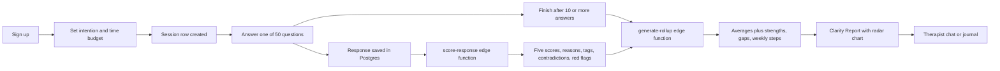
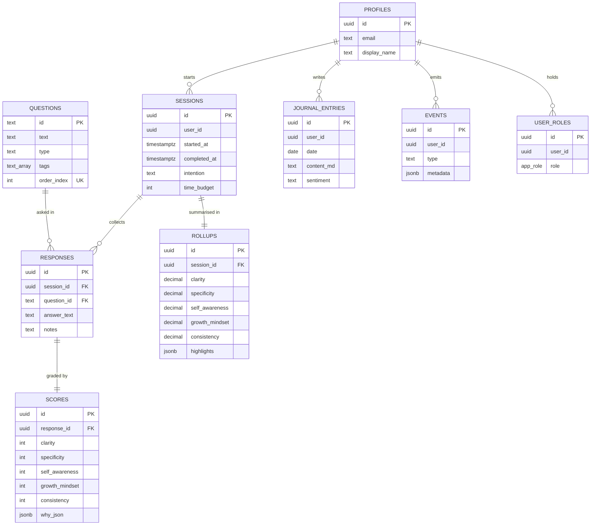

<!-- presentation:start -->
<p align="center"></p>

## Summary

Self Introspection is a web app that walks a person through 50 guided questions about success, worth, fear, discipline and legacy, then scores every answer on five dimensions and turns the scores into a report.
Answers are saved in Postgres under row level security; three Supabase edge functions call a language model to score each answer, roll the scores up into a radar chart with strengths, gaps and weekly recommendations, and run a coaching chat.
What is unusual is the loop: each answer is graded for clarity, specificity, self awareness, growth mindset and consistency, with a written reason per dimension, and contradictions and red flags are stored next to the score.
It also ships a daily journal and states plainly on its home page that it is not a substitute for therapy.

## At a glance

| Measure | Value |
|---|---|
| Guided questions seeded in the database | 50 (47 long text, 3 activities) |
| Scoring dimensions | 5: clarity, specificity, self awareness, growth mindset, consistency, each 1 to 5 |
| Screens | 7: Home, Auth, Onboarding, Questions, Results, Therapist, Journal |
| Routes | 7 plus a catch all |
| Edge functions | 3 (`score-response`, `generate-rollup`, `therapist-chat`), 227 lines of Deno TypeScript |
| Coaching chat styles in the function | 3: compassion, socratic, goal oriented (the page uses compassion) |
| Session lengths offered | 3: 10, 20 and 40 minutes |
| Database tables | 9 |
| Row level security policies | 22 |
| Triggers | 5 (4 timestamp triggers and 1 that creates a profile on sign up) |
| Question tags in the seed | 66 |
| Application code, excluding the UI kit | 2,064 lines of TypeScript and TSX |
| SQL | 2 migrations, 355 lines |
| Source files in `src/` | 69, of which 49 are the shadcn UI kit |
| History | 17 commits of product work on 3 and 4 Oct 2025 |

## What it is

Self Introspection is a private reflection tool built around a fixed question set. A person signs up, sets an intention for the session ("Why are you here today?") and a time budget, and starts answering. The interface shows a progress bar, a sidebar listing all 50 questions with a tick on the answered ones, a rotating quote (ten of them, from Socrates to Carl Jung), a large answer box and a separate private notes box.

The questions are not generic prompts. They are specific and uncomfortable: the definition of success, true potential, true worth, the biggest regret, what is holding you back, which kind of mentor you want to become, what legacy to leave. Three of them are activities: list five things you could become, watch a talk and say what it means to you, and write 25 goals and narrow them to one.

Once at least 10 answers exist the person can finish and see a Clarity Report: a five axis radar chart, top strengths, growth areas and next steps for the week. From the report they can open a coaching chat or the daily journal.

## Why it was built

Most people have never written down, in full sentences, what they want or why. When they try, three things happen:

1. The answer is vague ("I want to be successful") and nothing pushes back.
2. Answers to different questions quietly contradict each other and nobody notices.
3. There is no way to tell, a month later, whether the thinking got sharper.

A journal alone does not fix this because a blank page gives no structure and no feedback. A generic chatbot does not fix it either, because it has no fixed question set and no scoring, so two sessions cannot be compared. This project fixes the question set, scores each answer on the same five dimensions, and saves the scores, so reflection becomes something with a shape.

## How it works



1. **Onboarding.** `Onboarding.tsx` writes a `sessions` row with the intention and `time_budget` of 10, 20 or 40 minutes (default 20) and logs an event.
2. **Answering.** `Questions.tsx` loads all questions ordered by `order_index`, restores any saved answer for the session, and upserts on the pair `session_id, question_id`, so editing an answer never duplicates it. Skip, previous and jump to any question are all available.
3. **Scoring.** After each save the page calls `score-response` in the background. The function loads the response with its question, asks the model for strict JSON with five 1 to 5 scores, a one line reason per dimension, tags, contradictions and red flags, and upserts one `scores` row per response.
4. **Finishing.** The Finish button appears after 10 answers. It stamps `completed_at` on the session and calls `generate-rollup`. Answering question 50 does the same automatically.
5. **Rollup.** `generate-rollup` averages every score of the session, asks the model for strengths, gaps, contradictions, weekly recommendations (title, why, steps, success signal) and three reflection prompts, and upserts a `rollups` row.
6. **Report.** `Results.tsx` reads the rollup, waits 3 seconds and retries once if the model is still working, and draws the radar chart.
7. **Coaching.** `Therapist.tsx` sends the conversation to `therapist-chat` with the compassion style: a supportive, non clinical coach, under 180 words per reply, ending with one open question.

## What makes it different

<p align="center"></p>

| | A blank journal | A chatbot | A personality quiz | Self Introspection |
|---|---|---|---|---|
| Fixed, ordered question set | No | No, open prompt | Yes, multiple choice | Yes, 50 written questions |
| Free text answers | Yes | Yes | No | Yes, plus private notes per answer |
| Feedback on the quality of the answer | None | Ad hoc | None | 5 scored dimensions with a reason for each |
| Spots contradictions across answers | No | Only within one chat | No | Stored per answer as `contradictions` and `red_flags` |
| Comparable across sessions | No | No | Type label only | Same questions, same 5 scores, one rollup per session |
| Coaching conversation | No | Yes | No | Yes, 3 styles in the function |
| Data stored per user with access rules | Paper or app dependent | Provider dependent | Provider dependent | Row level security on all 9 tables |

## Features

| Feature | Where in the code |
|---|---|
| Email and password auth with automatic profile and role | `Auth.tsx`, `handle_new_user` trigger |
| 50 seeded questions with tags, type and order | `questions` table, seed in the first migration |
| Intention and time budget before each session | `Onboarding.tsx`, `sessions.intention`, `sessions.time_budget` |
| Progress bar, answered ticks, jump to any question | `Questions.tsx` (426 lines) |
| Mobile question list in a slide in sheet | `Questions.tsx`, `Sheet` component |
| Private notes next to every answer | `responses.notes` |
| Quote shown for each question, 10 quotes | `MOTIVATIONAL_QUOTES` in `Questions.tsx` |
| Per answer scoring on 5 dimensions with reasons | `score-response`, `scores` table with `CHECK` of 1 to 5 and `why_json` |
| Tags, contradictions and red flags per answer | `scores.tags`, `scores.contradictions`, `scores.red_flags` |
| Session rollup with strengths, gaps and a weekly plan | `generate-rollup`, `rollups.highlights` |
| Radar chart of the 5 dimensions on a 0 to 5 scale | `RadarChart.tsx`, Recharts |
| Coaching chat with three prompt styles | `therapist-chat`, `Therapist.tsx` |
| One journal entry per day with last saved time | `Journal.tsx`, `journal_entries` unique on user and date |
| Usage events for analytics | `events` table, written on start, answer, view and chat |
| Roles | `app_role` enum with admin and user, assigned on sign up |

Current status:

- **Chat styles.** The function supports compassion, socratic and goal oriented prompts, and the page always sends compassion. There is no style picker yet.
- **Chat memory.** The chat is not saved; only an event with the message count is written.
- **Journal sentiment.** `journal_entries.sentiment` exists in the schema and no page fills it.
- **Skipped questions.** A person can skip, and the report is built from the questions that were answered.

## By the numbers

<p align="center"></p>

Lines of code per page and component, UI kit excluded. The question screen is the largest file by far, because it holds navigation, progress, saving and the finish logic.

<p align="center"></p>

Row level security policies per table, 22 in all. Every one of the 9 tables has at least one.

<p align="center"></p>

Lines in each of the three edge functions. The two that write results are the longest; the chat function is stateless.

## Architecture



Read from `supabase/migrations`. Profiles share their id with Supabase `auth.users`, which owns the sessions, journal and events through `user_id`.

| Folder or module | What it holds |
|---|---|
| `src/pages/` | Index, Auth, Onboarding, Questions, Results, Therapist, Journal, NotFound |
| `src/components/` | `AppNav` (title and back link on every inner page), `RadarChart` |
| `src/components/ui/` | 49 shadcn and Radix components |
| `src/integrations/supabase/` | Typed client and generated types |
| `supabase/functions/score-response` | Grades one answer, writes `scores` |
| `supabase/functions/generate-rollup` | Averages scores, writes `rollups` |
| `supabase/functions/therapist-chat` | Stateless coaching chat with 3 system prompts |
| `supabase/migrations/` | Schema, policies, triggers and the 50 question seed; a follow up fixes the function search path |

## Tech stack

| Technology | What it does here |
|---|---|
| React 18 and TypeScript | Interface and types |
| Vite and React Router | Build tool and 7 routes |
| Tailwind CSS, shadcn/ui, Radix | Layout and 49 components |
| Recharts | The five axis radar chart |
| Supabase Auth and Postgres | Accounts, 9 tables, row level security, triggers |
| Supabase Edge Functions on Deno | The three AI functions |
| Gemini 2.5 Flash through the Lovable AI gateway | Scores answers, writes the rollup, answers chat |
| TanStack Query | Provider mounted for data access |

## Run it locally

Scripts from `package.json`:

```bash
npm install
npm run dev        # Vite dev server
npm run build      # production build
npm run lint       # ESLint
```

Scoring, rollups and chat need the edge functions deployed to a Supabase project, with `LOVABLE_API_KEY` set as a function secret. Apply the two SQL files in `supabase/migrations/` first so the questions exist.

## Who it is for

- People who want to think clearly about career, purpose or direction and prefer questions to a blank page.
- Students and early career professionals preparing for a big decision.
- Mentors and coaches who want a fixed question set and a comparable score for each person.
- Builders who want a worked example of an AI scoring pipeline: queue free text, grade it with a fixed rubric, store structured JSON, roll it up.

## FAQ

**What is a self introspection questionnaire?**
A set of questions you answer in writing about your goals, strengths, fears and values. Here there are 50, and each answer is graded so you can see where your thinking is vague.

**How are the answers scored?**
Each answer gets 1 to 5 on clarity, specificity, self awareness, growth mindset and consistency, with a short reason for each. The report shows the averages for the session on a radar chart.

**Do I have to answer all 50 questions?**
No. You can finish after 10 answers. Answering all 50 ends the session automatically.

**Is it therapy?**
No. The home page says it is not a substitute for therapy, and the chat prompts tell the model to stay non clinical and give no medical advice.

**Who can see my answers?**
Row level security allows a user to read only their own sessions, responses, scores, rollups, journal entries and events. The question list is readable by signed in users.

**Can I keep a daily journal?**
Yes. The journal keeps one entry per day, saved as markdown text, and it is separate from the questionnaire.

Built by [Rohit Swerashi](https://github.com/therohitji), Founder & CEO of [GeniOS](https://thegenios.com).
<!-- presentation:end -->
