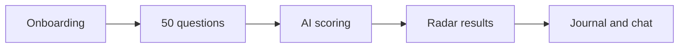

<!-- presentation:start -->
<p align="center"></p>

## What it is

A self-discovery app that scores your answers and tracks them over time.

## Why it exists

Know yourself, then decide.

## How it works



## What's inside

| Part | What |
|---|---|
| **AI** | Answer scoring, rollups, reflective chat |
| **Screens** | Questions, Results, Journal, Onboarding |

**Stack:** React, TypeScript, Supabase, Edge Functions

## Run it

```bash
npm install
npm run dev
```

---

Built by [Rohit Swerashi](https://github.com/therohitji), Founder & CEO of [GeniOS](https://thegenios.com).
<!-- presentation:end -->
