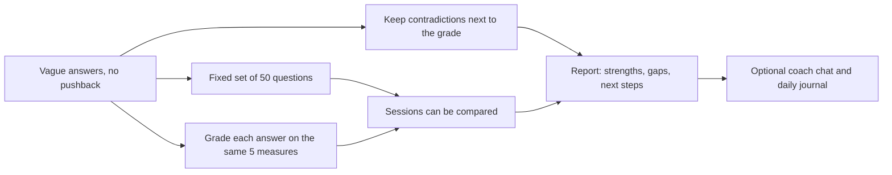
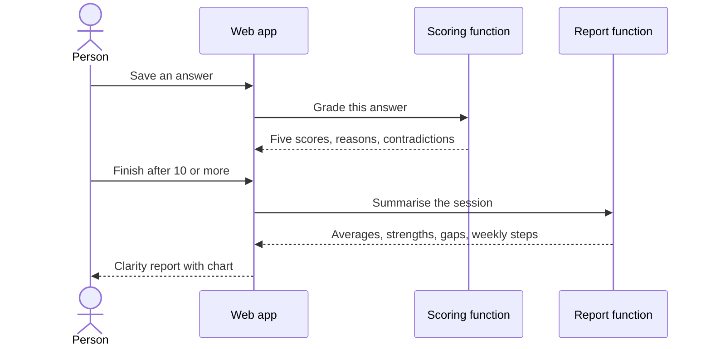

<!-- presentation:start -->
<p align="center"></p>

Self Introspection walks a person through 50 written questions about success, worth, fear, discipline and legacy, grades each answer for how clear it is, and ends with a short report on where their thinking is vague. It is for anyone who has never written down what they want. It is a working prototype generated with Lovable, and it says on its home page that it is not therapy.

## The problem

Most people have never written down, in full sentences, what they want and why. When they try, three things happen.

1. The answer is vague ("I want to be successful") and nothing pushes back.
2. Answers to different questions quietly disagree with each other, and nobody notices.
3. A month later there is no way to tell whether the thinking got sharper.

A blank journal gives no structure and no feedback. A chatbot gives feedback but no fixed set of questions, so two sessions cannot be compared. I had no study behind this. The questions in the product are the problem statement: they are the uncomfortable ones, such as what you regret most and what is holding you back, and I wanted to see what a fixed set with a fixed grading scale would show a person about their own answers.

## How I approached it

The idea was to give reflection a shape: same questions, same five measures, one report per session.



**Key decisions**

| Decision | Why | Trade-off |
|---|---|---|
| A fixed set of 50 questions, not an open chat | Two sessions can be compared | The questions do not adapt to the person |
| Grade every answer on clarity, specificity, self awareness, growth mindset and consistency, with a one line reason | A score alone teaches nothing; the reason shows what to fix | The grader is a language model's judgment, and I have not measured how reliable it is |
| Store contradictions and red flags with each grade | The useful finding is often two answers that disagree | They surface only through the model, so a miss is silent |
| Allow a report after 10 answers | People stop when it gets long, and a partial report beats none | A report built from 10 answers is thin |
| A coach that is supportive but not clinical, with short replies ending in one question | It should push the person to think, not to depend on it | The chat is not saved between visits |
| Access rules on all 9 tables | These are private reflections | Rules are harder to change than screen code |

## What I built

| What exists | In plain words | Where |
|---|---|---|
| Question flow | Progress bar, list of all 50 questions, private notes beside each answer, a rotating quote | `src/pages/Questions.tsx` |
| Session start | A stated intention and a 10, 20 or 40 minute budget | `src/pages/Onboarding.tsx` |
| Answer grading | Five scores with reasons, tags, contradictions and red flags per answer | `supabase/functions/score-response` |
| Report | Five axis chart, strengths, gaps, weekly steps, three reflection prompts | `supabase/functions/generate-rollup`, `Results.tsx` |
| Coach chat | Non clinical, replies under 180 words | `supabase/functions/therapist-chat` |
| Daily journal | One entry per day | `src/pages/Journal.tsx` |
| Database and rules | 9 tables, 22 access policies, the 50 questions as seed data | `supabase/migrations/` |

## How it works

1. The person signs up and says why they are here today and how long they have.
2. They answer one question at a time. Each answer is saved, and can be edited without creating a duplicate.
3. After each save, the answer is graded in the background.
4. After 10 answers they can finish, and answering question 50 finishes automatically.
5. The five grades are averaged, and a model writes strengths, gaps and weekly steps.
6. The report shows the chart. From there they can open the coach or the journal.



## What makes it different

<p align="center"></p>

| | A blank journal | A chatbot | A personality quiz | Self Introspection |
|---|---|---|---|---|
| Fixed, ordered questions | No | No | Yes, multiple choice | Yes, 50 written questions |
| Free text answers | Yes | Yes | No | Yes, plus private notes |
| Feedback on the answer itself | None | Ad hoc | None | Five scores, each with a reason |
| Notices contradictions | No | Only within one chat | No | Stored per answer |
| Comparable across sessions | No | No | A type label only | Same questions, same scores |
| Private by default | Depends | Depends on the provider | Depends | Each person reads only their own rows |

## By the numbers

<p align="center"></p>

The question screen is a fifth of the application code. That is where the experience lives: saving, moving between questions and finishing.

<p align="center"></p>

Every one of the 9 tables has at least one access policy, 22 in all. The journal table has the most, four.

## What this shows

- I treat a soft problem, self knowledge, as something with a measurable shape: fixed questions and a fixed scale.
- The grader gives a reason with every score, so a person can argue with it.
- Private writing gets database level access rules from the first migration.
- I say plainly what the tool is not. The home page states that it is not therapy.

## What I would do next

- Test the grader. Ask a few people to rate the same answers and compare.
- Save the coach conversation, and add a style picker. The function already supports three styles and the page only uses one.
- Fill the journal sentiment field, which exists and is never written.
- Show a person how their scores change across sessions, which the data already allows.

## Tech stack

| Technology | Role |
|---|---|
| Lovable | Generated the app and its AI gateway. All 17 product commits are its bot |
| React 18 and TypeScript, Vite | Interface and build |
| Tailwind, shadcn/ui, Recharts | Layout, 49 ready made components, the chart |
| Supabase | Sign in, Postgres with row level security, three serverless functions |
| Gemini 2.5 Flash | Grades answers, writes the report, runs the chat |

## Run it locally

```bash
npm install
npm run dev
npm run build
```

Grading, reports and chat need the three functions deployed to a Supabase project with a `LOVABLE_API_KEY` secret. Apply the two SQL files in `supabase/migrations/` first so the questions exist.

Built by [Rohit Swerashi](https://github.com/therohitji), Founder & CEO of [GeniOS](https://thegenios.com). [Book a call](https://cal.com/rohitswerashi/genios).

<!-- presentation:end -->
